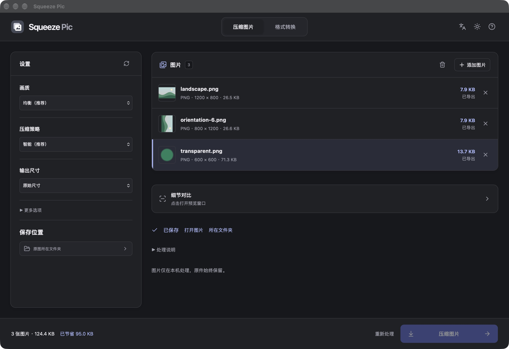
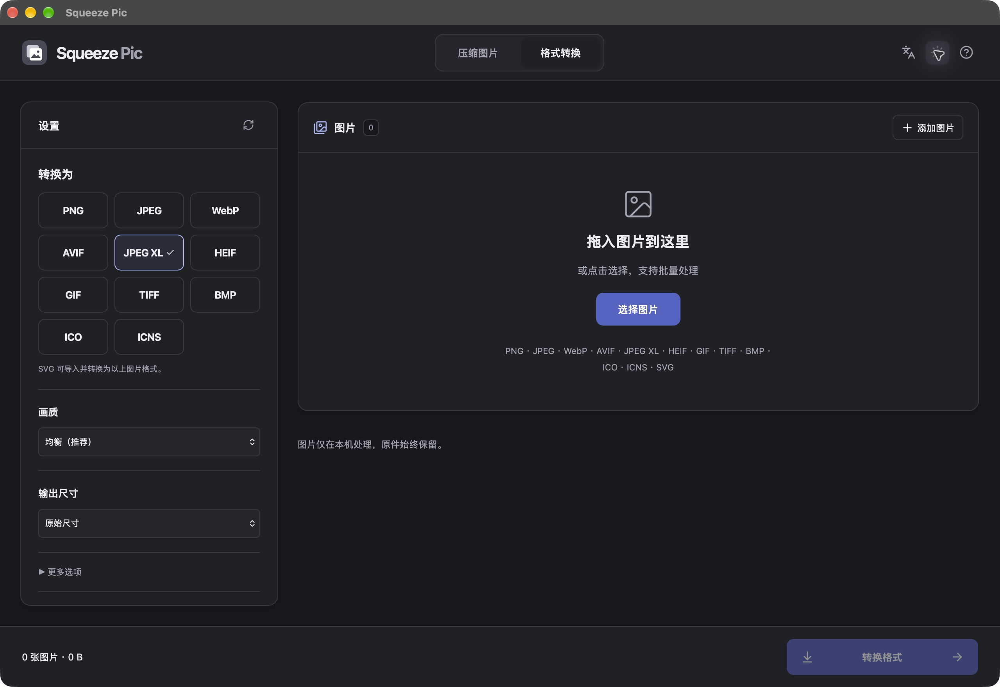
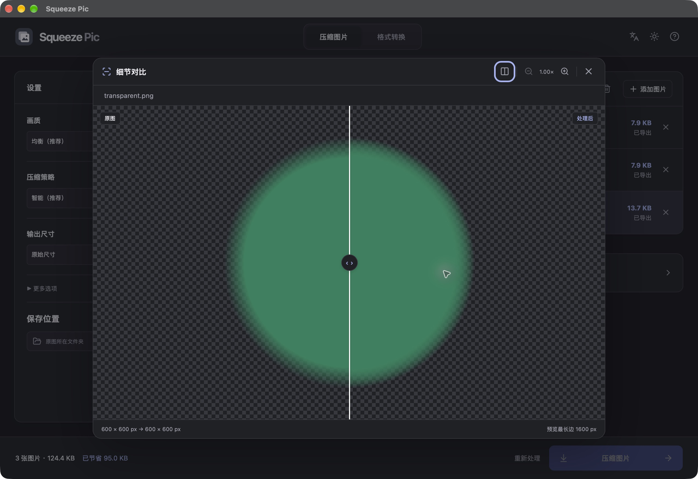

# Squeeze Pic 0.2.2 验证记录

日期：2026-10-12 至 2026-10-14。环境：macOS Apple silicon，Rust 1.92.0，Node.js 23.11.0。

## 自动检查

- Rust 核心 28 项测试：4 项 JPEG 系数域测试、1 项 sRGB 混合回归测试、2 项 PNG 编码路径测试，21 项处理流程测试。
- `cargo test --workspace --locked`：核心、CLI、桌面 crate 均参加检查。
- `cargo fmt --all -- --check`、`cargo clippy --workspace --all-targets --locked -- -D warnings`。
- `npm run check` 与 Vite 前端构建。

测试覆盖 11 种静态输出格式往返、SVG 光栅转换、图标等比缩放与补边、GIF 动画拒绝、JPEG XL 严格无损隐藏 RGB，及 JPEG / PNG / WebP 往返、PNG / WebP 透明像素中的隐藏 RGB、JPEG DCT 系数/量化表/采样/标记保留、RGB ICC 保留与 sRGB 转换、EXIF 方向校正、等比缩放、不放大、透明边缘重采样、输出扩展名与尺寸、取消、原件被外部修改、输出同名竞争、损坏 PNG/JPEG、16 位和动画拒绝。

WebP 编码由 libwebp 完成，结果由 image 的纯 Rust 解码器检查；JPEG 系数域测试额外比较系数、量化和标记，避免只依赖视觉预览。

0.2.1 新增 PNG 无损调色板/低位深灰度、透明像素隐藏 RGB、RGB ICC 色彩类型兼容性及 sRGB 混合快速路径的回归验证。优化前后的尺寸、耗时及 JPEG / WebP 文件校验值对照见[压缩优化记录](PERFORMANCE.md)。

0.2.2 新增生成 PNG 的 ICC / EXIF / XMP / 文本 / pHYs 保留、快速 PNG 内容分流、TIFF 三种策略的 Deflate / straight-alpha 标记与逐像素回归、BMP 直接编码透明与隐藏 RGB 回归。原件复核使用 64 KiB 分块哈希并保留输入变更与大小限制检查。第二轮测量调用最终安装包的 worker，两项 4MP 样本的峰值 RSS 分别下降约 39% 与 31%，见[深度优化记录](PERFORMANCE-0.2.2.md)。

## 本机操作验证

已在实际 Tauri 原生窗口验证文件选择器多选导入三张图片、图片信息/缩略图、PNG 批量转 WebP、最长边 600 px、结果报告、原图与成品解码预览、分割对比及明暗主题。普通图由 1200 × 800 输出为 600 × 400，方向 6 图片由可见 800 × 1200 输出为 400 × 600，透明图保持 600 × 600。浏览器界面另验证格式选择、百分比尺寸和严格无损互斥。

0.2.0 将压缩与转换拆成两个入口，设置移到左侧，去掉重复标题说明，改用中性灰明暗主题。细节对比改为点击打开的居中弹窗，更多选项默认收起。

原生窗口完成三图 PNG 同格式压缩及三图 JPEG XL 转换，检查了缩略图、结果状态、弹窗原图/结果加载与 Esc 关闭。早期构建另完成失败后重试、并排对比、分割对比与明暗主题往返检查。

最终构建去掉按钮颜色过渡，修复原生 WebKit 切换工具/格式后的选中色残留；已检查 JPEG XL 与工具按钮在明暗主题下均正确显示当前选中项。

CLI 对生成的 1200 × 800 PNG 样本执行 WebP 转换并限制最长边为 600，输出实际为 600 × 400。压缩率只描述测试样本，不代表真实照片或截图的平均表现。

开发样本由 `cargo run -p squeeze-pic-core --example make_samples` 生成，包括普通图片、透明边缘和 EXIF 方向 6。样本保存在被忽略的 `tmp/samples/`，不混入用户原图。

## 分发状态与待验证项

- 已生成并运行优化的 macOS arm64 `.app`，使用本地 ad-hoc 签名，`codesign --verify --deep --strict` 通过。
- 已生成 DMG 并通过 `hdiutil verify`；公开发行所需的 Developer ID 签名与公证尚未配置。
- `otool -L` 检查 worker 只动态链接 macOS 系统库/框架，无 Homebrew 图片库运行依赖。
- 安装包随带独立 Rust worker；图片处理不依赖浏览器或外部图片程序。
- 第三方清单由锁定的 Cargo / npm 依赖生成，并收集可用许可文本；对外公开分发前仍需核对没有独立许可文件的依赖条目及完整分发要求。
- Windows x64、macOS Intel 构建/安装回归未完成；不将本机成功视为跨平台验证通过。
- 80–120 张真实图片回归、真实图片/低内存机器的峰值内存、磁盘满/只读目录、强制关闭恢复、发行签名/公证仍待完成。
- 当前预览以最长边 1600 px 展示已完成结果，实时参数候选预览和全尺寸像素检查仍待实现。

这些待办属于后续 P0 平台补验和 P3 完整回归，当前版本定位为可运行的本地试用版本。
